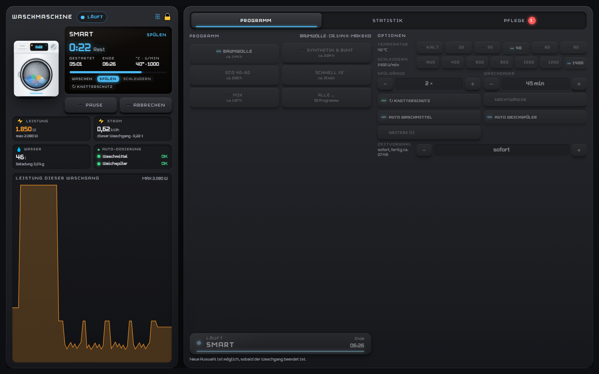

# Washer Control for Home Assistant

Custom integration for **Haier / Candy / Hoover washing machines connected via hOn**: start and control programs,
detect wash cycles, report "laundry done", keep a history with statistics, and remind you of maintenance tasks.
Optionally combines the data with a smart plug that measures power and energy.


*Companion card [Washer Card](https://github.com/SysriX/washer_ha_card): running program, power curve, consumption and program selection (UI in German)*

- Domain: `washer_control`
- Version: 1.1.1
- UI language of program names, states and maintenance tasks: German

> Built for the author's own home (Haier HW80 washer + Tasmota plug). It works generically, but the program list and
> phase mapping are based on that model.

## Features

- Binds directly to the coordinator of the [hOn integration](https://github.com/gvigroux/hon) (washers and washer-dryers,
  appliance types `WM`/`WD`); multiple machines supported.
- Start programs remotely (remote start must be enabled on the machine), pause, resume, stop.
- ~90 hOn programs with German names, grouped (on the machine, everyday, short, special textiles, stains, hygiene,
  detergent programs, machine care); favorites and last used parameters per program.
- Cycle detection (start / planned / running / paused / finished / aborted) with phase (wash, rinse, spin, …),
  progress, remaining time, water and energy.
- "Laundry done" flag – cleared when the door is opened, the next cycle starts or it is acknowledged.
- History of the last 500 cycles (program, duration, water, energy, plug kWh and power curve), price per kWh for costs.
- Maintenance tasks with intervals in washes and/or days (drum cleaning – checked off automatically by the drum-clean
  program –, lint/pump filter, detergent drawer, door seal, descaling); editable in the card.
- Anti-crease option (enabled by default).
- Optional smart plug: power curve and measured kWh per cycle, plug on/off state.

## Entities

Per configured machine (`<id>` from the configuration, default `ku_washer`):

| Entity | Description |
|---|---|
| `sensor.<id>_status` | `bereit`, `laeuft`, `pausiert`, `geplant`, `fertig`, `fehler`, `beendet`, `getrennt`, `aus`, `test` – attributes: program, phase, start/end, remaining, progress, temperature, spin, water, energy, door, errors, detergent warnings, power … |
| `binary_sensor.<id>_done` | On when a cycle has finished ("Wäsche fertig") |
| `sensor.<id>_maintenance` | Number of due maintenance tasks (attributes `faellig`, `bald`, `tasks`) |

Events: `washer_control_started`, `washer_control_finished` (`result` fertig|abgebrochen, `program`, `name`, `minutes`,
`water`, `energy`) – use them for notifications.

## Services

| Service | Description |
|---|---|
| `washer_control.start` | Start a program (`program`, e.g. `hqd_cottons`; optional `parameters` such as `{"temp": "40", "spinSpeed": "1200"}`; optional `washer`) |
| `washer_control.command` | `pause`, `resume` or `stop` |
| `washer_control.acknowledge` | Dismiss the "laundry done" notice |
| `washer_control.task_done` | Mark a maintenance task as done (`task`, e.g. `filter`) |

`washer` is the machine id; if omitted, the first machine is used. WebSocket API for the card: `washer_control/get`,
`/programs`, `/start`, `/command`, `/task`, `/settings`, `/ack`, `/history_delete`, `/refresh`, `/debug`.

## Requirements

- Home Assistant 2024.6 or newer
- [hOn integration by gvigroux](https://github.com/gvigroux/hon) (HACS). Washer Control reads its internal coordinators,
  so other hOn integrations are not supported.
- Optional: a smart plug with power/energy sensors

## Installation

### HACS (custom repository)

1. HACS → ⋮ → **Custom repositories** → add `https://github.com/SysriX/washer_control_ha_integration`, category **Integration**.
2. Install **Washer Control** and restart Home Assistant.

### Manual

Copy `custom_components/washer_control` to `/config/custom_components/washer_control` and restart Home Assistant.

## Configuration

`configuration.yaml` (no config flow):

```yaml
washer_control:
  devices:
    - id: ku_washer               # entity prefix → sensor.ku_washer_status …
      name: Waschmaschine
      room: ku                    # optional room code
      # hon_device: <device_id>   # optional, otherwise the first hOn washer
      plug:                       # optional smart plug
        power: sensor.washer_plug_power
        energy: sensor.washer_plug_energy_total
        switch: switch.washer_plug
```

`washer_control:` without options creates one machine with id `ku_washer`.
History, settings and maintenance tasks are stored in `.storage/washer_control`.

## Companion cards

- [washer_ha_card](https://github.com/SysriX/washer_ha_card) – washer card (overview, programs, statistics, maintenance)
- [kitchen_appliances_ha_card](https://github.com/SysriX/kitchen_appliances_ha_card) – kitchen appliance overview

## License

MIT – see [LICENSE](LICENSE).
